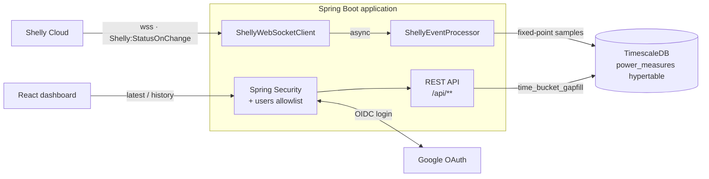

# Shelly DIY Dashboard

[](https://github.com/dkBrazz/shelly-diy-dashboard/actions/workflows/ci.yml)
[](https://github.com/dkBrazz/shelly-diy-dashboard/pkgs/container/shelly-diy-dashboard)
[](LICENSE)

A self-hosted dashboard for Shelly three-phase energy meters. It subscribes to the
[Shelly Cloud real-time events API](https://shelly-api-docs.shelly.cloud/cloud-control-api/real-time-events),
stores every status update in TimescaleDB, and serves an authenticated React dashboard
with live readings and voltage/current history per phase.

<!-- Drop a screenshot at docs/screenshot.png and uncomment:

-->

## Features

- Live voltage, current, power and temperature per phase for every meter on your Shelly account
- Voltage and current history from 5 minutes to 1 week, plus custom ranges, with outages drawn as gaps
- Efficient storage: fixed-point integers in a compressed TimescaleDB hypertable
- Google sign-in with an explicit email allowlist, so only you (and whoever you add) can see your data
- Single container, published to GitHub Container Registry, with a Docker Compose stack included

Currently supported devices are three-phase meters that report an `em:0` status component, such as the
Shelly Pro 3EM. Other devices on the account are ignored.

## How it works



- `ShellyWebSocketClient` keeps one WebSocket per configured Shelly region alive (ping/pong, timeouts, reconnects).
  Multiple regions are intentional: a device shared with you by another Shelly user lives on *that* user's
  server, so events for it never arrive on your own region. The Shelly Cloud control UI subscribes to every
  region in the same way.
- `ShellyEventProcessor` scales each sample by 1,000 and stores it as integers in the `power_measures` hypertable.
- `/api/devices/{id}/history` aggregates with TimescaleDB `time_bucket_gapfill`, so graphs stay smooth at any zoom level.
- `/actuator/health` is public and used by the container health check; everything else under `/api/**` requires login.

## Quick start with Docker Compose

You need Docker, a Shelly Cloud account with at least one supported meter, and a Google account.

### 1. Get a Shelly Cloud authorization code

The dashboard authenticates to Shelly Cloud with the public `shelly-diy` OAuth client, as described in the
[Shelly docs](https://shelly-api-docs.shelly.cloud/cloud-control-api/real-time-events#oauth-as-per-rfc6749).

1. Open this URL in a browser and sign in with your Shelly account:

   ```
   https://my.shelly.cloud/oauth_login.html?client_id=shelly-diy&redirect_uri=http://localhost:8080/
   ```

2. After login the browser is redirected to `http://localhost:8080/?code=...`. Nothing is listening there yet,
   so the page shows a connection error — that is expected. Copy the value of the `code` parameter from the
   address bar; it is your `SHELLY_AUTH_CODE`.
3. The code is a JWT whose `user_api_url` claim names your Shelly server (for example
   `shelly-241-eu.shelly.cloud`). The dashboard reads it from the code, uses it for the token exchange and
   always monitors that region for events, so no region has to be configured for your own devices.

Treat the code like a password: anyone holding it can control your devices. Repeat this step if the
dashboard logs `Failed to refresh Shelly access token`.

### 2. Create a Google OAuth client

1. In [Google Cloud Console](https://console.cloud.google.com/apis/credentials) create a project and configure the
   **OAuth consent screen** (External). While the app is in *Testing* status, add your own Google account as a test user.
2. Go to **Credentials → Create credentials → OAuth client ID**, type **Web application**.
3. Add the authorized redirect URI `http://localhost:8080/login/oauth2/code/google`. For a public deployment use
   `https://your-host/login/oauth2/code/google` instead.
4. Copy the client ID and secret into `GOOGLE_CLIENT_ID` and `GOOGLE_CLIENT_SECRET`.

### 3. Configure and run

```bash
cp .env.example .env
# edit .env: database password, Google client, APP_ALLOWED_EMAILS, Shelly code
docker compose up -d
```

Open <http://localhost:8080>, sign in with a Google account listed in `APP_ALLOWED_EMAILS`, and wait for the
first status change from your meter. Devices appear automatically as soon as their first event arrives.

Useful commands:

```bash
docker compose logs -f app          # watch Shelly WebSocket and ingestion logs
docker compose pull && docker compose up -d   # upgrade to the latest published image
docker compose build                # build the image locally instead of pulling it
docker compose down                 # stop; add --volumes to delete all measurements
```

## Configuration

All settings are environment variables. `.env.example` lists every key; Docker Compose reads `.env` directly.

| Variable | Default | Purpose |
|---|---|---|
| `DB_HOST`, `DB_PORT`, `DB_NAME`, `DB_USER`, `DB_PASSWORD` | `localhost`, `5432`, `shelly`, `postgres`, — | PostgreSQL/TimescaleDB connection. Under Compose, host and port are overridden to the internal `timescaledb` service and `DB_PORT` only sets the host port mapping. |
| `GOOGLE_CLIENT_ID`, `GOOGLE_CLIENT_SECRET` | — | Google OAuth web client. |
| `APP_ALLOWED_EMAILS` | empty | Comma-separated Google account emails seeded into the `users` allowlist on every startup. Existing rows are never removed, so you can also manage the table by hand. |
| `APP_PORT` | `8080` | Host port for the dashboard under Compose. |
| `SHELLY_AUTH_CODE` | — | Authorization code from step 1. |
| `SHELLY_CLIENT_ID` | `shelly-diy` | OAuth client id; keep the default unless Shelly issued you an integrator id. |
| `SHELLY_WEBSOCKET_REGIONS` | `shelly-241-eu,shelly-242-eu` | Additional regions monitored for real-time events; the region from the code's `user_api_url` is always included. Keep every region that hosts a device you can see in the Shelly app, including devices shared with you by users on other servers; your own region alone only covers devices registered to your account. |
| `SHELLY_REGION` | unset | Deprecated override of the Shelly server used for the token exchange. Normally derived from the authorization code; setting it logs a warning. |
| `APP_IMAGE_TAG` | `main` | Image tag pulled by Compose (`main`, a release tag such as `1.0.0`, or `sha-…`). |

Dashboard behaviour (`shelly.dashboard.*` in `application.yml`): `max-measures` caps the number of history buckets per
request (150; larger `measures` values are clamped), `max-range` the widest history window a single request may cover
(90 days; wider or inverted ranges are rejected with HTTP 400) and `offline-threshold` the silence after which a gap is
drawn as zero instead of being bridged (30 s).

## Running from source

Prerequisites: Java 25 (the Gradle toolchain resolver can download it), Node.js 22 or newer, Docker for the database.

```bash
docker compose up -d timescaledb                      # database only
./gradlew bootRun -PskipFrontend --args='--spring.profiles.active=local'
```

The `local` profile imports `.env` as Spring properties, so no exporting is needed. In a second terminal:

```bash
cd frontend
npm ci
npm run dev
```

Vite serves the UI on <http://localhost:5173> and proxies `/api`, `/login`, `/logout` and `/oauth2` to the backend.
Because the OAuth callback is derived from the browser URL, also register
`http://localhost:5173/login/oauth2/code/google` in your Google client for this setup.

### Validate

```bash
./gradlew check --no-daemon              # npm ci + lint + type-check + frontend build + backend tests
./gradlew test -PskipFrontend --no-daemon  # backend only
cd frontend && npm run check              # frontend only
```

Generated frontend assets are written to `src/main/resources/static` and are not committed.

## Deployment notes

- Put the container behind a TLS-terminating reverse proxy. `server.forward-headers-strategy=native` is enabled, so
  standard `X-Forwarded-*` headers are honoured when building OAuth redirect URIs.
- `GET /actuator/health` returns `{"status":"UP"}` without authentication and is used by the image's `HEALTHCHECK`.
- Login sessions last 30 days (`server.servlet.session.*`).
- `src/main/resources/schema.sql` runs on every startup and is idempotent. Back up the `timescaledb-data` volume
  before upgrading across schema changes.

## Project layout

| Path | Contents |
|---|---|
| `src/main/kotlin/org/dkbrazz/websocket` | Shelly Cloud WebSocket client and connection state machine |
| `src/main/kotlin/org/dkbrazz/service` | Event processing, token exchange, allowlist seeding, history queries |
| `src/main/kotlin/org/dkbrazz/controller` | REST API consumed by the dashboard |
| `src/main/kotlin/org/dkbrazz/model`, `repository` | Entities, DTOs, fixed-point scaling, Timescale queries |
| `src/main/resources/schema.sql` | Startup schema (hypertable, compression, readable view) |
| `frontend/src` | React 19 + TypeScript dashboard (Vite, Tailwind, Recharts) |

## Contributing

Issues and pull requests are welcome. Run `./gradlew check --no-daemon` before opening a PR, keep Kotlin DTOs and
`frontend/src/types.ts` in sync, and treat `schema.sql` changes as production data migrations. `AGENTS.md`
holds the detailed conventions for contributors and coding agents.

## License

[MIT](LICENSE)
